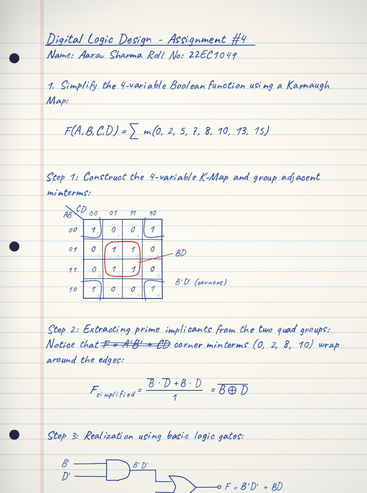

# ScriptForge Studio

Dynamic stroke, 2D math and hand-drawn diagram engine. Turns a plain-text document into a
hand-written notebook page rendered as vectors — with every glyph uniquely perturbed, so no two
letters on the page are ever identical.



## Features

- **Allographic glyph engine** — each character is sliced into micro-strips and warped with
  continuous Perlin noise, affine shear and pressure-modulated ink, so a page of `a` and `e`
  never looks like a font.
- **2D spatial LaTeX** — a real parser and renderer for fractions, integrals and sums with
  limits, radicals, matrices, overbars, sub- and superscripts, drawn as strokes rather than
  typeset.
- **Hand-sketched diagram engine** — Karnaugh maps with implicant loops, IEEE logic-gate
  schematics, DFA state graphs, damped-response plots.
- **Image → hand-traced vector** — upload any printed diagram and it is thresholded, traced into
  contours and re-drawn with pen tremor.
- **Paper and camera realism** — ruled / quad-grid / Cornell stationery, fibre grain, spine
  curvature, phone-camera shadow and vignette.

## Running it

The app uses native ES modules, so browsers will not load it from a `file://` path. Serve the
folder over HTTP:

```bash
npm run dev        # http://localhost:8000
```

No dependencies to install — `npm run dev` uses the bundled zero-dependency static server in
`scripts/serve.mjs`. Any other static server works too:

```bash
python3 -m http.server 8000
npx serve .
```

> **Network required on first load.** Tailwind, Rough.js, Lucide and the handwriting fonts are
> loaded from CDNs. Offline, the page will still load but the layout and sketching will be
> degraded.

## Document markup

The editor accepts plain prose plus a small markup language:

| Syntax | Renders as |
|---|---|
| `# Heading` | Larger, hand-underlined heading |
| `$$ ... $$` | Display 2D math on its own lines |
| `$ ... $` | Inline 2D math inside a sentence |
| `[DIAGRAM: kmap \| ones=0,2,5,7]` | A Karnaugh map with those minterms set |
| `[DIAGRAM: circuit]` | A logic-gate schematic |
| `[DIAGRAM: dfa]` | A state automaton |
| `[DIAGRAM: plot \| label=Response]` | A damped-response function plot |
| `[DIAGRAM: custom_image]` | A contour trace of an uploaded image |
| `~~wrong term~~` | A multi-pass pen scratch-out |

## Module map

```
index.html                  Shell markup. Controls declare intent via data-action / data-arg.
assets/styles/app.css       Extracted stylesheet.
docs/screenshot.png         Rendered sample page.
scripts/serve.mjs           Zero-dependency static dev server.
src/
  main.js                   Entry point: boots the studio on window load.
  core/
    config.js               Canvas geometry, HiDPI factor, ink palettes. Pure data.
    noise.js                Deterministic Perlin/value noise engine.
    state.js                The single mutable state store (seed, ink, inspector, contours).
    options.js              Reads the live control-panel values into the render options.
  data/
    presets.js              The three demo documents.
  render/
    glyph.js                Allographic glyph + word rendering (the zero-clone engine).
    math/
      parser.js             LaTeX -> 2D AST (fractions, integrals, matrices, radicals).
      measure.js            AST bounding-box measurement.
      renderer.js           AST -> hand-drawn strokes.
    diagrams/
      index.js              Dispatcher: parses the spec, builds the ink style, routes by type.
      primitives.js         Rounded rectangle and arrowhead helpers.
      kmap.js               Karnaugh map with implicant loops.
      circuit.js            IEEE logic-gate schematic.
      dfa.js                Deterministic finite automaton.
      plot.js               Function plot with damping envelope.
      customImage.js        Vectorized uploaded-image contours.
    paper.js                Stationery background, spine shadow, camera lighting.
    page.js                 Full-page compositor — lays the document out on the canvas.
  pipeline/
    vectorize.js            Image -> luminance-gradient edges -> chained polylines.
  ui/
    controls.js             The actions the interface can trigger.
    events.js               Delegated data-action wiring.
    vlm.js                  Optional vision-language document parser.
```

## Adding a feature

- **A new control** — add `data-action="..."` to the element in `index.html`, then add an entry
  to the matching map in `src/ui/events.js` (`CLICK_ACTIONS`, `CHANGE_ACTIONS` or
  `INPUT_ACTIONS`) and the action function in `src/ui/controls.js`. Sliders use
  `data-arg="<input id>"` plus an optional `data-suffix` for the readout (`slantAngle` uses `°`).
- **A new diagram type** — write `src/render/diagrams/<type>.js` exporting `draw<Name>(d)` and
  return the vertical space consumed, then register it in `src/render/diagrams/index.js`. The `d`
  context object is documented at the top of that file.
- **A new math primitive** — add a node type in `src/render/math/parser.js`, a measurement rule
  in `measure.js`, and a render rule in `renderer.js`.
- **New render state** — add it to `src/core/state.js`. Do not reintroduce page-level globals;
  they are what made the original single file hard to extend.

## Known limitations

- Only the `ones` (K-map) and `label` (plot) diagram parameters are actually honoured.
  `vars=`, `expr=`, `states=`, `accept=` and `fn=` are parsed into the diagram context but the
  renderers still draw their default geometry — see `src/render/diagrams/circuit.js` and `dfa.js`.
- The DFA renderer's return arcs from the accepting state are drawn as smooth curves but are not
  yet annotated with their transition labels.
- The optional Gemini key in the VLM modal is read from the DOM and sent directly to Google's
  API from the browser. It is never stored or committed, and the app works fully offline
  without it.

## Provenance

This project was split out of a single 2090-line monolithic HTML file. The split was verified
pixel-identical against the original: the rendered canvas bytes, ten interactive control
behaviours, and the full image-to-diagram pipeline all match exactly. The original file remains
in the git history in the first commit.
