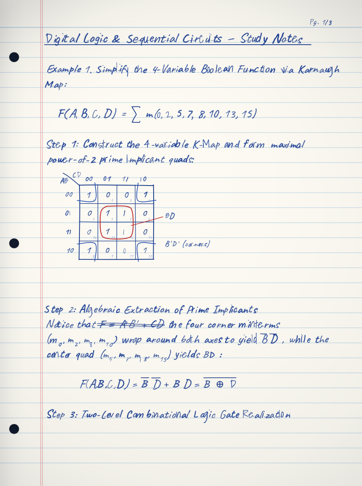

# ScriptForge

**Write the idea. Forge the notes.**

ScriptForge is a browser-native compiler for handwritten notebook pages. You write a
compact, declarative document — prose, LaTeX-style mathematics, diagrams and 2D sketch
scenes — and ScriptForge turns it into deterministic hand-drawn ink, lays it out across
real notebook pages, and exports a multi-page PDF or PNG. No cloud, no build step, no API
key, no drawing tablet.

It is a study-guide engine, an engineering-diagram compiler and an AI-native note format
in one package.

[**▶ Try the live studio**](https://shyler-web.github.io/scriptforge-handwriting/) ·
[**Authoring guide**](docs/notes-authoring.md) ·
[**Agent skill**](skills/scriptforge-notes/SKILL.md) ·
[**MCP setup**](#use-it-from-an-agent)



---

## What makes it different

| Ordinary note tool | ScriptForge |
|---|---|
| You draw every stroke | You describe the page; ScriptForge draws every stroke |
| A handwriting font repeats the same glyphs | An **allographic engine** warps every character with unique noise, slant and pressure |
| Diagrams are separate images | Diagrams, math and prose share one paginated document |
| Layout is manual | Multi-column flow, floating figures, text wrapping and collision avoidance |
| Cloud rendering and accounts | 100% local rendering, local PDF compilation, local notes |
| AI generates a wall of text | Agents write validated DSL through an MCP server |

The result is not a screenshot of handwriting. It is vector ink generated from geometry:
each glyph, rule line, graph edge and hatching stroke is sampled with a deterministic seed,
so the same document can be reproduced exactly — or resampled with one click.

---

## Contents

- [What you can build](#what-you-can-build)
- [The language in 60 seconds](#the-language-in-60-seconds)
- [The universal sketch engine](#the-universal-sketch-engine)
- [From notes to wall charts](#from-notes-to-wall-charts)
- [Built for agents](#built-for-agents)
- [Studio features](#studio-features)
- [Quick start](#quick-start)
- [Use it from an agent](#use-it-from-an-agent)
- [Document grammar](#document-grammar)
- [Architecture](#architecture)
- [Verification](#verification)
- [Security and privacy](#security-and-privacy)
- [Known limitations](#known-limitations)
- [Provenance](#provenance)

---

## What you can build

| Domain | What ScriptForge draws |
|---|---|
| **Mathematics** | Fractions, roots, matrices, piecewise cases, integrals, sums and limits, aligned derivations, Greek and set/logic notation — laid out as hand-drawn 2D math |
| **Graphs & theory** | Binary trees, BSTs, recursion trees, DAGs, flowcharts, force/circular/bipartite graphs, Hasse diagrams, spanning-tree highlights, degree labels |
| **Digital logic** | Karnaugh maps, bitfields, register strips, logic circuits, flip-flops, DFAs and state machines |
| **CS systems** | Timing waveforms, linked lists, B-trees, stack/heap activation records, pipeline waterfalls, Gantt charts, packet headers |
| **Chemistry** | Skeletal carbon chains, double/triple bonds, wedge/dash stereobonds, cyclohexane chairs, Newman projections |
| **Discrete math** | 2- and 3-set Venn diagrams with arbitrary Boolean shading, domain/codomain mappings, bottom-up Hasse posets |
| **Physics** | Inclined planes with free-body components, Atwood machines, thin-lens ray traces, electrostatic streamlines, vector fields |
| **3D & calculus** | Painter-sorted 3D surfaces, midpoint/trapezoid Riemann sums, 2×2 matrix transformations, ODE slope fields with RK4 trajectories |
| **Page design** | A4 notebooks, 2-column A4 cheat sheets, 3-column A3 landscape charts, 4-column wall charts, floats, pinned figures and wrapped text |

The **Demos** bar in the studio loads five complete examples: Spatial Cheat Sheet, Organic
Chemistry, CS Systems, Physics & Optics, and 3D & Calculus.

---

## The language in 60 seconds

A ScriptForge document is plain text. This one file mixes frontmatter, prose, display math,
a graph and a sketch:

```markdown
---
title: Graph Traversal
tags: dsa, graphs, bfs
font: Kalam
ink: ballpoint_blue
paper: ruled_margin
seed: 4219
---

# Breadth-first search

BFS visits vertices in layers and runs in:

$$ O(V + E) $$

[DIAGRAM: graph | nodes=A,B,C,D | edges=A-B,A-C,B-D,C-D | layout=layered]

[sketch:
  title "BFS frontier"
  row at=(0, 0) nodes="Queue,Visited,Next" gap=120
  arrow Queue -> Visited
  arrow Visited -> Next
]
```

Rendered output is a handwritten page with a titled heading, ruled paper, hand-set
mathematics, a layered graph and a labelled row of boxes. Change `seed` and every glyph and
diagram tremor is resampled. Change `paper` and the stationery changes. Add more content
and ScriptForge paginates automatically — without splitting an equation or a figure across
pages.

The complete grammar, options and examples live in
[`docs/notes-authoring.md`](docs/notes-authoring.md). The agent-facing version is
[`skills/scriptforge-notes/SKILL.md`](skills/scriptforge-notes/SKILL.md).

---

## The universal sketch engine

`[sketch: ...]` is the heart of ScriptForge. It is a small declarative geometry language
with anchors, relative placement, obstacle-aware routing, physics solvers and domain-specific
renderers.

### Layouts and routing

```markdown
[sketch:
  title "Compiler pipeline"
  dag dir=LR edges="Lexer->Parser->AST->Codegen"
]

[sketch:
  node A at=(0, 0) "Source"
  node Block right="of A" gap=45 "Obstacle"
  node B right="of Block" gap=45 "Target"
  arrow A -> B route=ortho label="bypass"
  arrow A -> A loop=n label="self"
]
```

- Reingold–Tilford trees and BSTs, with `_` phantom children and recursion-tree costs.
- Sugiyama DAGs with crossing reduction and automatic back-edge loops.
- Deterministic force, circular and bipartite graph layouts.
- TikZ-style `right="of A"`, `between="A,B"`, `alignX` and `alignY`.
- Manhattan A* orthogonal routing, curved obstacle avoidance, ports (`.n`, `.s`, `.e`, `.w`),
  self-loops and symmetric parallel-edge bends.
- ASCII arrows (`->`, `--`, `<->`, `|->`) and typographic arrows (`→`, `⇒`, `↔`, `⇔`, `↦`)
  are normalised automatically.

### Physics, optics and fields

```markdown
[sketch:
  incline at=(0, 0) angle=30 mass="$m$" friction="$f_k$" components=true
  atwood r=28 m1="$m_1$" m2="$m_2$"
  optics at=(0, 180) kind=convex f=65 u=125 h=40
  charges at=(0, 360) q1=1 q2=-1 rays=10
  vectorfield at=(0, 540) fx="-y" fy="x"
]
```

- `incline` / `fbd`: ramp geometry, rotated block, `mg`, normal force, friction and dashed
  `mg sin θ` / `mg cos θ` components.
- `atwood`: exact external or crossed pulley tangents with hanging masses.
- `optics`: thin-lens principal rays, focal markers and image construction.
- `charges`: RK4 electrostatic streamlines around one or more charges.
- `vectorfield`: quiver grid for arbitrary `fx` / `fy` expressions.

### Computer systems

```markdown
[sketch:
  waveform at=(0, 0) signals="CLK:P......., D:0.1..0.., Q:x.01..0., BUS:=A0..=FF.."
  linkedlist at=(0, 120) values="10, 20, 35, 50" head="head" pointers="1:slow, 3:fast"
  memframe id=Stack at=(-100, 240) title="Stack" fields="argc: 2, ptr: ->Heap.0"
  memframe id=Heap at=(100, 240) title="Heap" fields="val: 42, next: NULL"
]

[sketch:
  btree edges="20|40 -> 5|10|15, 20|40 -> 25|30, 20|40 -> 45|55"
  pipeline rows="ADD R1,R2: IF ID EX MEM WB | SUB R3,R1: _ IF ID STALL EX MEM"
  gantt tasks="P1:0..4, P2:4..7, P3:7..11"
  packet bits=32 fields="Src Port:16, Dst Port:16, Seq Num:32"
]
```

- Wavedrom-style timing diagrams with clocks, buses, don't-care and high-Z states.
- Singly, doubly and circular linked lists with labelled pointers.
- Slotted B-tree nodes where child pointers originate between keys.
- Stack/heap frames with addressable slots and cross-frame pointer arrows.
- CPU pipeline waterfalls with stall/bubble hatching, OS Gantt bars and byte-aligned packets.

### Chemistry and discrete math

```markdown
[sketch:
  chain at=(0, 0) carbons=6 bonds="2:=, 5:#" branches="3:^OH, 4:=O, 2:_Br"
  wedge C1 -> C2
  dash C2 -> C3
  chair at=(0, 140) axial="1:OH, 4:CH3" equatorial="2:Br"
  newman at=(220, 140) angle=60 front="CH3,H,H" back="Br,H,CH3"
  venn at=(0, 300) sets="A,B,C" shade="(A&B)-C"
  mapping at=(240, 300) domain="1,2,3" codomain="x,y" pairs="1->x, 2->y, 3->y"
  hasse at=(0, 480) edges="1->2, 1->3, 2->6, 3->6"
]
```

- Skeletal chains use 120° carbon geometry; `^` draws a solid wedge, `_` a dashed bond and
  `=` a double bond.
- Chair conformations support axial/equatorial substituents and ring flipping.
- Venn shading accepts full Boolean expressions with `&`, `|`, `-`, `^` and `!`.
- Mappings and Hasse diagrams are laid out automatically.

### 3D surfaces, calculus and ODEs

```markdown
[sketch:
  surface3d fn="0.35*(x^2 - y^2)" xrange=(-2.5,2.5) yrange=(-2.5,2.5) steps=12
]

[sketch:
  riemann fn="0.2*x^2 + 0.5" domain=(0,4) n=6 method=mid
]

[sketch:
  matrixgrid matrix="1.4, 0.5, 0.3, 1.1" range=2 det=true
]

[sketch:
  slopefield dy="x - y" solutions="(-2, 1.5), (-2, -0.5)"
]
```

- `surface3d` projects `z = f(x, y)` with Painter's algorithm and hidden-line occlusion.
- `riemann` supports left, right, midpoint and trapezoid partitions.
- `matrixgrid` draws the reference lattice, transformed grid, determinant parallelogram and
  transformed basis vectors.
- `slopefield` integrates solution curves forward and backward with RK4.

---

## From notes to wall charts

Page size is part of the document:

```markdown
@page size=a4
@page size=a4-2col
@page size=a3-landscape cols=3
@page size=chart-xl cols=4
```

| Preset | Canvas | Columns | Best for |
|---|---:|---:|---|
| `a4` | 820 × 1100 | 1 | Normal handwritten notes |
| `a4-2col` | 820 × 1100 | 2 | Dense revision sheets |
| `a3-landscape` | 1560 × 1100 | 3 | Chapter summaries and posters |
| `chart-xl` | 1920 × 1360 | 4 | Mega wall charts |

Any diagram can float, pack or pin itself:

```markdown
[sketch:
  @layout place=right w=44% scale=0.9
  title "Chair Conformation"
  chair axial="1:OH, 4:CH3" equatorial="2:Br"
]
```

- `place=right` / `place=left` floats beside prose and wraps text around the figure.
- `place=row` packs compact figures side-by-side on a shelf.
- `place=xy(x,y)` / `pin=(x,y)` pins a figure and resolves collisions.
- `w=45%`, `size=sm|md|lg|full` and `scale=0.5..2` resize any diagram.
- `[DIAGRAM: ...]` accepts the same keys inline.

The compositor tracks per-column exclusions, so text never runs through a figure and
side-by-side diagrams do not overlap. Explicit `@page` settings override the studio selector.
PDF export uses the active canvas aspect ratio, so A4, 2-column, A3 and wall-chart pages all
export correctly.

---

## Built for agents

ScriptForge is designed to be written by a human **or an AI coding agent**.

### MCP server

A zero-dependency MCP server exposes the note library over stdio. The agent supplies the
model; ScriptForge supplies storage, validation and rendering. There are no API keys,
network calls or shell access in the MCP path.

| Tool | Purpose |
|---|---|
| `get_authoring_guide` | Full grammar, frontmatter keys and diagram types |
| `list_notes` | Public or private notes with title, tags, path and timestamp |
| `read_note` | Raw content, frontmatter and body for a slug |
| `create_note` | Create a validated note, optionally overwriting |
| `update_note` | Replace an existing note with validated content |
| `append_to_note` | Append a validated section |
| `delete_note` | Delete a note; requires `confirm: true` |
| `validate_note` | Line-numbered validation with a minimal example on failure |

Validation is grounded in the renderers: unsupported LaTeX, malformed diagrams, unbalanced
sketch blocks and bad frontmatter are rejected **before** a note lands. Failures include line
numbers so an agent can correct itself without guessing.

### Downloadable skill

The complete agent skill is
[`skills/scriptforge-notes/SKILL.md`](skills/scriptforge-notes/SKILL.md). It documents the
workflow, every diagram command, layout rules, the math allowlist, recipes and troubleshooting.
Download it from the **AI Skill** button in the studio; the fetch is `no-store`, so it always
matches the running build.

### A useful prompt

> Call `get_authoring_guide`. Create a public note `dsa/graphs/traversal` explaining BFS with a
> layered graph diagram and the complexity equation. Validate it, then open
> `/?note=dsa/graphs/traversal`.

---

## Studio features

- **Live compile** — edit the document and pages re-render immediately.
- **Insert palette** — 44 searchable presets across Math, Diagrams, Layouts, CS & Systems,
  Chemistry, Discrete, Physics, 3D & Calculus, Page and Text.
- **Expanded canvas** — click any page or **Expand** for a full-screen, scrollable stack of
  every page.
- **Five complete demos** — Spatial Cheat Sheet, Organic Chemistry, CS Systems, Physics &
  Optics, 3D & Calculus.
- **Style presets** — Classic Blue, Engineering Grid, Pencil Draft, Cornell Focus, Red Pen
  and Clean Print, with full control over ink, paper, hand font, tilt, grain, shadow and
  vignette.
- **Zero-clone proof** — the inspector highlights glyph bounding boxes, per-character warp
  seeds, slant deltas and scale matrices.
- **Image tracer** — upload a diagram; Zhang–Suen 1px thinning and RDP simplification turn it
  into single-pass pen strokes, fully offline.
- **Notes library** — load public notes or local private notes written through MCP/CLI, with
  live reload and an agent-skill download.
- **PDF and PNG export** — true multi-page PDF 1.4 built in the browser, one JPEG XObject per
  page, plus current-page PNG.

---

## Quick start

Requires **Node.js 18+**. There are no runtime dependencies.

```bash
npm run dev
# open http://localhost:8000
```

Any static server rooted at the project directory works:

```bash
python3 -m http.server 8000
# or
npx serve .
```

The studio boots with a demo notebook. Edit the markup, use **Insert Diagram / Block**, switch
canvas size, then export. Native ES modules require HTTP; opening `index.html` as a `file://`
URL will not work.

---

## Use it from an agent

### opencode

`opencode.json`:

```json
{
  "$schema": "https://opencode.ai/config.json",
  "mcp": {
    "scriptforge": {
      "type": "local",
      "command": ["node", "/absolute/path/to/ScriptForge/mcp/server.mjs"],
      "enabled": true
    }
  }
}
```

### Claude Desktop and other MCP clients

```json
{
  "mcpServers": {
    "scriptforge": {
      "command": "node",
      "args": ["/absolute/path/to/ScriptForge/mcp/server.mjs"]
    }
  }
}
```

### Notes API without MCP

```bash
npm run notes -- list --scope public
npm run notes -- read dsa/graphs
npm run notes -- create dsa/trees --title "Trees" --tags dsa,trees --file section.md
npm run notes -- validate --file section.md
npm run notes -- index
```

Public notes live in `notes/<slug>.md` and are tracked. Private notes live in
`notes/private/<slug>.md` and are git-ignored. A slug beginning with `private/` selects
private scope automatically.

Open a note directly:

```text
http://localhost:8000/?note=dsa/graphs/traversal
http://localhost:8000/?note=private/scratch
```

---

## Document grammar

| Syntax | Renders as |
|---|---|
| `# Heading` … `###### Heading` | Hand-underlined heading |
| `$ ... $` | Inline 2D math |
| `$$ ... $$` | Display 2D math (single-line or `$$` block) |
| `~~wrong term~~` | Multi-pass pen scratch-out |
| `---PAGE---` / `[PAGEBREAK]` | Forced page break |
| `[DIAGRAM: grid \| cols=A,B \| rows=1~2,3~4]` | Hand-ruled table |
| `[DIAGRAM: bitfield \| bits=32 \| fields=Op:6,R1:4,…]` | Segmented register strip |
| `[DIAGRAM: kmap \| vars=A,B,C,D \| ones=0,2,5,7]` | Karnaugh map |
| `[DIAGRAM: circuit \| expr=(A AND B) OR C]` | Logic schematic |
| `[DIAGRAM: dfa \| states=q0,q1 \| accept=q1 \| edges=q0->q1:0]` | State automaton |
| `[DIAGRAM: tree \| edges=50->30,50->70]` | Binary tree |
| `[DIAGRAM: graph \| nodes=A,B,C \| edges=A-B,B-C]` | General graph |
| `[DIAGRAM: canvas2d \| fn=4*x^3 \| domain=0,1]` | Function plot |
| `[DIAGRAM: svg \| <svg …>…</svg>]` | Arbitrary SVG, re-inked by hand |
| `[sketch: …]` | Multi-line declarative math/geometry scene |

Hard rules:

1. Display math is one line or a `$$` block; block content is collapsed before rendering.
2. Every inline `$` must close on the same line.
3. A diagram block must start at the beginning of its own line and end with `]`.
4. A diagram value may not contain a literal `|`; it is the parameter separator.
5. Math is an allowlist, not full LaTeX. Unsupported commands fail validation.

The full reference — every sketch command, graph parameter, page directive and math
construct — is in [`docs/notes-authoring.md`](docs/notes-authoring.md).

---

## Architecture

```text
index.html                  Studio shell; delegated data-action UI.
notes/                      Public notes + generated index.
shared/note-format.mjs      Frontmatter parsing shared by browser and Node.
mcp/
  server.mjs                MCP stdio transport (JSON-RPC).
  tools.mjs                 Tool definitions and handlers.
  notes-store.mjs           Path-jailed CRUD, atomic writes, scoped indexes.
  note-schema.mjs           DSL validator grounded in the renderers.
src/
  main.js                   Boot and notes-library initialization.
  core/                     Config, noise, state, render options.
  render/
    page.js                 Multi-page compositor, wrapping and pagination.
    spatialLayout.js        Page presets, exclusion manager, collision solver.
    sketch/                 Universal sketch compiler:
      vecmath.js            Vectors, splines, hatching, 3D projection.
      strokes.js            Parametric strokes and mechanical symbols.
      layout.js             Trees, DAGs, graphs, anchors, arrow normalisation.
      router.js             A* orthogonal and curved obstacle routing.
      physics.js            Inclines, pulleys, optics, RK4 fields.
      systems.js            Waveforms, lists, B-trees, memory, pipelines.
      chemistry.js          Chains, stereobonds, chairs, Newman projections.
      discrete.js           Venn shading, mappings, Hasse diagrams.
      calculus3d.js         3D surfaces, Riemann sums, matrices, slope fields.
      engine.js             Statement parser and unified renderer.
    diagrams/               Tables, K-maps, circuits, automata, graphs, SVG.
    math/                   LaTeX parser, measure pass and 2D renderer.
    glyph.js, paper.js      Allographic glyphs, paper and camera realism.
    pdfExport.js            Client-side multi-page PDF 1.4 writer.
  ui/                       Controls, events, insert palette, notes, tracer.
scripts/
  serve.mjs                 Zero-dependency static server.
  notes-cli.mjs             MCP-free note operations.
  verify-waves.mjs          Renderer, math, diagram and secret-leak checks.
  verify-sketch.mjs         Universal sketch geometry and DSL tests.
  verify-spatial.mjs        Placement, wrapping and cheat-sheet tests.
  verify-skill.mjs          Guards the agent skill and download entry point.
  verify-notes.mjs          Note store, validator and index tests.
  verify-mcp.mjs            End-to-end MCP stdio smoke test.
  qa/                       Headless-Chrome assertion suites.
assets/                     Self-hosted fonts, compiled Tailwind, vendored Rough.js.
docs/                       Screenshot and authoring guide.
skills/scriptforge-notes/   Complete agent SKILL.md + maintenance checklist.
```

---

## Verification

```bash
npm run verify          # renderer + sketch + spatial + skill guards
npm run verify:notes    # note store, validator, MCP transport and indexes
```

Individual suites:

```bash
node scripts/verify-waves.mjs
node scripts/verify-sketch.mjs
node scripts/verify-spatial.mjs
node scripts/verify-skill.mjs
```

Browser QA requires the dev server:

```bash
npm run dev
node scripts/qa/harness.mjs scripts/qa/wave1.assertions.js
node scripts/qa/harness.mjs scripts/qa/wave2.assertions.js
node scripts/qa/harness.mjs scripts/qa/wave3.assertions.js
node scripts/qa/harness.mjs scripts/qa/style-presets.assertions.js
node scripts/qa/harness.mjs scripts/qa/sketch.assertions.js
QA_VIEWPORT=375,812 node scripts/qa/harness.mjs scripts/qa/mobile.assertions.js
```

If you change Tailwind utility classes, regenerate the stylesheet:

```bash
node scripts/build-tailwind.mjs
```

---

## Security and privacy

- Rendering, pagination, PDF compilation, image tracing and note validation all run locally.
- The MCP server has no network access, no shell access and no credentials. It reads and
  writes only inside `notes/`; path traversal and absolute paths are rejected.
- Writes are capped at 256 KB, validated before they land and performed atomically.
- `delete_note` requires `confirm: true`.
- `notes/private/` and its index are git-ignored. Personal PDFs, notebooks, archives and
  internal planning material are ignored too.
- The image tracer is fully offline (1px Zhang–Suen centerline tracing). No API key is read
  or stored.
- Lucide icons load from a CDN and fail gracefully offline; everything else is self-hosted.

---

## Known limitations

- Pagination uses an upper-bound block estimate, so a page can end slightly early rather than
  clip content.
- Not every legacy diagram parameter is honoured by every alias; the universal engines
  (`grid`, `schematic`, `canvas2d`, `graph`, `svg`, `sketch`) have the widest coverage.
- DFA return-arc labels are drawn as curves but are not yet annotated.
- The zero-clone inspector currently visualises the slant delta only.
- The browser reader is read-only. Agents write notes through MCP or the CLI; the studio
  loads them and can export the rendered result.

---

## Provenance

ScriptForge was split out of a single 2090-line HTML file. The split was verified
pixel-identical against the original: rendered canvas bytes, interactive control behaviour
and the image-to-diagram pipeline all match. Vendored assets retain their original licences;
see `assets/vendor/rough.LICENSE`, `assets/fonts/OFL.txt` and `assets/fonts/NOTICE.md`.

MIT licensed. See [LICENSE](LICENSE).
